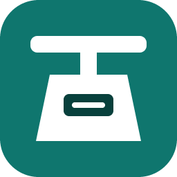
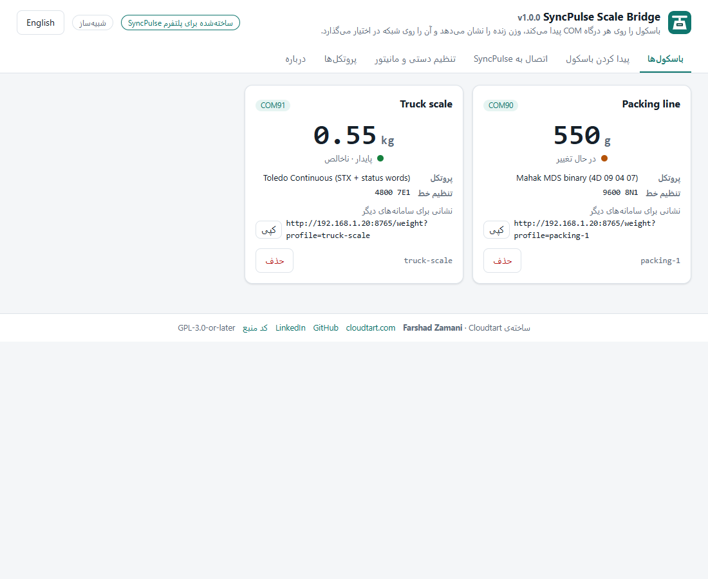
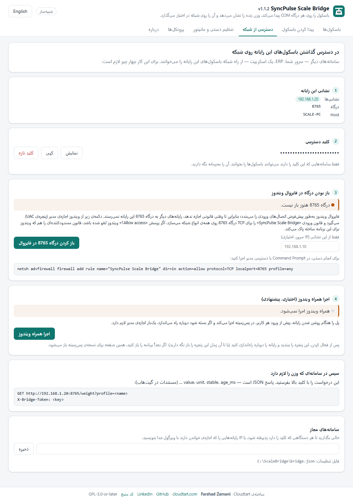

<div dir="rtl">

<p align="center"></p>

<h1 align="center">SyncPulse Scale Bridge</h1>

<p align="center">
باسکول دارای درگاه RS-232 را به هر رایانه‌ی ویندوزی وصل کنید و یک فایل را اجرا کنید؛ درگاه، سرعت و پروتکل را
خودش پیدا می‌کند، وزن زنده را نشان می‌دهد و آن را به‌صورت JSON روی شبکه در اختیار می‌گذارد.
</p>

<p align="center"><a href="README.md">English</a> · <b>فارسی</b></p>

---

ساخته‌ی **[فرشاد زمانی](https://github.com/farshad-zamani)** در **[کلادتارت (Cloudtart)](https://cloudtart.com)** برای پلتفرم
**SyncPulse** — پلتفرم فرم‌های دیجیتال، سوابق تولید و گزارش‌گیری کارخانه، که وزن را مستقیم در فرمی که اپراتور پر
می‌کند می‌نشاند. این برنامه نرم‌افزار آزاد است و با رابط ساده‌ی HTTP/JSON با هر سامانه‌ی دیگری هم کار می‌کند.

<p align="center">


</p>

## چرا

بیشتر باسکول‌ها و نمایشگرهای توزین صنعتی هنوز با درگاه سریال کار می‌کنند و هر برند قالب، سرعت و تنظیم خط خودش
را دارد. معمولاً برای وصل کردن یک باسکول باید دفترچه را پیدا کرد، 9600 8N1 یا 2400 7E1 را حدس زد، برنامه‌ی
خواندن نوشت و آن را کنار باسکول روشن نگه داشت. این برنامه همه‌ی این کارها را انجام می‌دهد:

- **باسکول را خودش پیدا می‌کند** — روی هر درگاه COM با همه‌ی سرعت‌های رایج گوش می‌دهد، قالب ۷ بیتی با پریتی را
  تشخیص می‌دهد و سپس با زبان سازندگان اصلی از باسکول وزن می‌خواهد. فقط درخواست‌های خواندنی فرستاده می‌شود؛ هیچ‌وقت
  صفر، تار یا چاپ نمی‌کند.
- **قالب‌های زیادی را می‌خواند** — Mettler Toledo (MT-SICS و Toledo Continuous)، A&D، SMA (Rice Lake، Avery
  Weigh-Tronix، Cardinal، Fairbanks و…)، NCI، Ohaus، Sartorius SBI، CAS، خانواده‌ی چینی XK3190، محک MDS، هر متن
  خوانا، و قالب‌های دودویی/متنی دلخواه.
- **وزن را نشان می‌دهد و در اختیار می‌گذارد** — صفحه‌ی دوزبانه (فارسی/انگلیسی) روی همان رایانه، و API از نوع JSON با
  مقدار، واحد، پایداری، خالص/ناخالص، بیش‌ازظرفیت و بررسی checksum.
- **یک فایل، بدون نصب** — `SyncPulseScaleBridge.exe` را کنار باسکول کپی و اجرا کنید.
- **آماده‌ی محیط تولید** — قطع و وصل کابل USB و درگاه مشغول را تحمل می‌کند، درگاه فایروال را باز می‌کند و با یک دکمه
  همراه ویندوز اجرا می‌شود، کلید دسترسی دارد و گزارش کارش را در فایل نگه می‌دارد.

## شروع سریع (ویندوز)

۱. فایل `SyncPulseScaleBridge.exe` را از [آخرین نسخه](https://github.com/farshad-zamani/syncpulse-scale-bridge/releases/latest)
بگیرید و روی رایانه‌ای که باسکول به آن وصل است، ترجیحاً در پوشه‌ی جداگانه مثل `C:\ScaleBridge\` کپی کنید (فایل
تنظیمات `bridge.json` و گزارش کار کنار آن ساخته می‌شود).

۲. درگاه RS-232 باسکول را مستقیم یا با مبدل USB به سریال وصل کنید و خروجی سریال نمایشگر را روشن کنید.

۳. برنامه را با دو بار کلیک اجرا کنید. یک پنجره‌ی کنسول باز می‌شود (باز بماند) و صفحه‌ی مدیریت در مرورگر با نشانی
`http://127.0.0.1:8765/` باز می‌شود.

۴. **پیدا کردن باسکول ← شروع جستجو.** وقتی باسکول پیدا شد، نامی به آن بدهید (مثلاً `packing-1`) و **ذخیره** را بزنید.
زبانه‌ی **باسکول‌ها** وزن زنده‌ی آن را نشان می‌دهد.

۵. **اتصال به SyncPulse:** نشانی و کلید دسترسی را بردارید، **باز کردن درگاه 8765 در فایروال** را بزنید و اگر باید
بدون ورود کاربر هم کار کند، **اجرا همراه ویندوز** را بزنید.

بدون دستگاه هم می‌توانید با باسکول شبیه‌سازی‌شده امتحان کنید:

<div dir="ltr">

```bat
SyncPulseScaleBridge.exe --simulate mahak_mds,toledo_cont:4800:7E1,mt_sics
```

</div>

## تشخیص خودکار چطور کار می‌کند

برای هر درگاه انتخاب‌شده:

۱. **گوش دادن** با سرعت‌های 9600، 2400، 4800، 19200، 1200، 38400، 57600 و 115200 (قالب 8N1). باسکولی که خودش
پیوسته می‌فرستد این‌جا دیده می‌شود. اگر بایت‌ها فقط با صفر کردن بیت بالا خوانا شوند، خط ۷ بیت داده با پریتی دارد و
دوباره با 7E1/7O1 گوش داده می‌شود. داده‌ی رسیده با همه‌ی قالب‌های پیوسته مقایسه می‌شود و قالب‌های دارای checksum بر
متن ساده مقدم‌اند.

۲. **پرسیدن** — اگر چیز مفیدی شنیده نشد، هر درخواست خواندنی کتابخانه با هر سرعت و قالب فرستاده می‌شود (سریع: ۸ حالت؛
کامل: ۱۴ حالت) و پاسخ با همان پروتکل بررسی می‌شود. پاسخ با یک پرسش دوباره تأیید می‌شود.

هر نتیجه درصد اطمینان، تنظیم دقیق خط، درخواست، نمونه‌ی داده‌ی خام و خوانش فعلی را دارد. اگر داده‌ی خوانا ولی با قالب
ناشناخته برسد، همان نمونه گزارش می‌شود تا در زبانه‌ی **تنظیم دستی و مانیتور** تنظیم شود.

### باسکول‌هایی که فقط با کلید «چاپ» می‌فرستند

بسیاری از نمایشگرها — به‌ویژه آن‌هایی که به لیبل‌زن وصل‌اند — تا اپراتور «چاپ» نزند چیزی نمی‌فرستند و بعد کل
برچسب را می‌فرستند. در «پیدا کردن باسکول» گزینه‌ی **باسکول فقط با زدن کلید چاپ داده می‌فرستد** (و در صورت تمایل
**فقط گوش بده**) را بزنید و وقتی صفحه خواست، چاپ بزنید. برای چنین باسکولی پل **همیشه** درگاه را باز نگه می‌دارد
و هر برچسب را ثبت می‌کند: وزن، واحد و بقیه‌ی مقادیر برچسب (شماره سفارش، شیفت، تاریخ …) در فایل
`labels/<profile>-YYYY-MM-DD.jsonl` و ۵۰۰ مورد آخر از `GET /labels`. برای اینکه لیبل‌زن هم کار کند، رایانه را
با **کابل Y** وصل کنید: TX باسکول (و زمین) هم به چاپگر و هم به RX رایانه؛ رایانه روی این خط چیزی نمی‌فرستد.

## قالب‌های پشتیبانی‌شده

<div dir="ltr">

| ID | Format | Talks |
|---|---|---|
| `mt_sics` | Mettler Toledo MT-SICS (`SI`) | on request |
| `toledo_cont` | Toledo Continuous (STX + status words, checksum) | continuous |
| `and_std` | A&D standard (`ST`/`US`/`OL`, `Q`) | on request / continuous |
| `sma` | SMA SCP-0499 (`<LF>W<CR>`) | on request |
| `nci` | NCI 3835 (`W<CR>`) | on request |
| `ohaus` | Ohaus (`IP`) | on request |
| `sartorius` | Sartorius SBI (`ESC P`) | on request |
| `cas_enq` | CAS ENQ/ACK/DC1 *(experimental)* | handshake |
| `xk3190_tf0` | XK3190 continuous (tF=0, XOR checksum) | continuous |
| `xk3190_reversed` | XK3190 `=` reversed-digit stream (tF=2/3) | continuous |
| `mahak_mds` | Mahak MDS binary (`4D 09 04 07`) — tested on real hardware | on request |
| `label_print` | label printer stream: TSPL / EPL2 / ZPL — tested on real hardware (PTC400) | on Print key |
| `ascii_generic` | any readable line with a number and a unit | continuous |
| `custom_binary` / `custom_ascii` | your own binary frame / regular expression | either |

</div>

قالب‌ها بر پایه‌ی مستندات منتشرشده‌ی سازندگان‌اند و با فریم‌های نمونه‌ی همان مستندات آزمایش شده‌اند؛ `mahak_mds` روی
باسکول واقعی (محک MDS 13000) آزموده شده است. نام برندها فقط برای توصیف قالب داده است و بسیاری از نمایشگرهای دیگر هم
همین قالب‌ها را به کار می‌برند.

## استفاده در SyncPulse

در SyncPulse: **دستگاه‌ها ← باسکول ← اتصال RS232**: نشانی پل = IP همین رایانه، درگاه = `8765`، کلید دسترسی = کلید
زبانه‌ی **اتصال به SyncPulse** ← قالب داده: **پروفایل روی پل** ← انتخاب پروفایل ← **تست اتصال**. سلول‌های فرم که
«دریافت از دستگاه» دارند، وقتی اپراتور روی آن‌ها می‌رود وزن را می‌گیرند.

پل قدیمی *SyncPulse Serial Bridge 1.x* را می‌توان مستقیم با این برنامه جایگزین کرد؛ `POST /read` و `bridge.json`
سازگارند و تنظیمات دستگاه‌های فعلی بدون تغییر کار می‌کنند.

## API برای هر سامانه‌ی دیگر

همه‌ی درخواست‌ها به‌جز `/health` سرآیند `X-Bridge-Token: <کلید دسترسی>` می‌خواهند.

<div dir="ltr">

```console
GET  /health
GET  /ports
GET  /profiles
GET  /weight?profile=packing-1
GET  /weight?port=COM7&protocol=mt_sics&baud=9600&framing=8N1
POST /weight   {"profile": "packing-1"}
POST /read     {serial, exchange, frames, max_age_ms, wait_ms}

$ curl -H "X-Bridge-Token: $KEY" "http://192.168.1.20:8765/weight?profile=packing-1"
{"ok": true, "value": 550.0, "unit": "g", "stable": true, "stale": false, "age_ms": 84, ...}
```

</div>

`stable` اگر قالب باسکول آن را بفرستد از خود باسکول است؛ وگرنه یعنی چند خوانش آخر (پیش‌فرض ۳) برابر بوده‌اند.
جزئیات کامل در [README انگلیسی](README.md#using-it-with-any-other-system--http-api).

## امنیت

- **کلید دسترسی** در اولین اجرا ساخته و در `bridge.json` نگه داشته می‌شود؛ هر زمان می‌توان کلید تازه ساخت.
- **سامانه‌های مجاز** — می‌توان فقط IP سرور SyncPulse را پذیرفت؛ قانون فایروال هم می‌تواند به یک نشانی محدود شود.
- **صفحه‌ی مدیریت فقط محلی است** — فقط روی خود رایانه (`127.0.0.1`) باز می‌شود و API آن سرآیند ویژه و Host محلی
  می‌خواهد تا صفحه‌های دیگر وب نتوانند آن را به کار بگیرند.
- **نسبت به باسکول فقط‌خواندنی است** — هیچ فرمان صفر، تار، چاپ یا تنظیم فرستاده نمی‌شود.

## فایروال و اجرا در پس‌زمینه

فایروال ویندوز به‌طور پیش‌فرض اتصال‌های ورودی را می‌بندد؛ پس تا قانونی اجازه ندهد، سرور SyncPulse به درگاه 8765 این
رایانه نمی‌رسد. دکمه‌ی **باز کردن درگاه 8765 در فایروال** اجازه‌ی مدیر می‌گیرد و این فرمان را اجرا می‌کند (برای انجام
دستی هم می‌توانید همین را در Command Prompt با دسترسی مدیر اجرا کنید):

<div dir="ltr">

```bat
netsh advfirewall firewall add rule name="SyncPulse Scale Bridge" dir=in action=allow protocol=TCP localport=8765 profile=any
```

</div>

اگر پرسش «Allow access؟» ویندوز در اولین اجرا لغو شده باشد، ویندوز قانون مسدودکننده برای برنامه می‌سازد که بر هر قانون
اجازه مقدم است؛ این دکمه آن را هم پاک می‌کند.

**اجرا همراه ویندوز** وظیفه‌ی زمان‌بندی‌شده‌ی *SyncPulse Scale Bridge* را می‌سازد: هنگام روشن شدن رایانه و پیش از ورود
کاربر با حساب SYSTEM اجرا می‌شود، پس از ۷۲ ساعت متوقف نمی‌شود و اگر بسته شود هر دقیقه دوباره اجرا می‌شود.

## رفع اشکال

- **درگاه COM دیده نمی‌شود / «A device attached to the system is not functioning»** — بسیاری از مبدل‌های ارزان تراشه‌ی
  CH340 یا PL2303 تقلبی دارند که درایورهای تازه آن را نمی‌پذیرند. برای CH340 درایور **3.5.2019.1** (از Microsoft
  Update Catalog) را نصب کنید، برای PL2303 درایور قدیمی‌تر Prolific، یا از مبدل FTDI استفاده کنید.
- **چیزی پیدا نشد** — خروجی سریال را در منوی نمایشگر روشن کنید (معمولاً `COM`، `rS`، `SEr`، `Serial`، `Continuous`
  یا `On request`)؛ کابل را بررسی کنید (نال‌مودم یا مستقیم — پایه‌های ۲، ۳ و ۵ کافی است)؛ هنگام جستجو چیزی روی باسکول
  بگذارید یا کلید چاپ را بزنید؛ جستجوی کامل را امتحان کنید؛ بایت‌های خام را در **تنظیم دستی و مانیتور** ببینید.
- **سرور وصل نمی‌شود** — قانون فایروال، IP و یکی بودن شبکه را بررسی کنید؛ `curl http://<ip>:8765/health` از سرور باید
  پاسخ دهد.
- **هشدار آنتی‌ویروس** — برنامه‌های تک‌فایلی ساخته‌شده با PyInstaller گاهی به‌اشتباه شناسایی می‌شوند. checksum
  SHA-256 منتشرشده با نسخه را مقایسه کنید یا برنامه را خودتان از کد منبع بسازید.

## ساخت از کد منبع

<div dir="ltr">

```bat
git clone https://github.com/farshad-zamani/syncpulse-scale-bridge
cd syncpulse-scale-bridge
scripts\build_exe.bat
```

</div>

## مجوز

[GPL-3.0-or-later](LICENSE) با یک شرط افزوده طبق بند ۷(ب): نام و مشخصات سازنده که برنامه نمایش می‌دهد — در پانویس
صفحه، صفحه‌ی «درباره»، فرمان `about` و پاسخ `/health` — باید در همه‌ی نسخه‌ها و نسخه‌های تغییر یافته حفظ شود.
[NOTICE.md](NOTICE.md) را ببینید.

## سازنده

**فرشاد زمانی** — [کلادتارت (Cloudtart)](https://cloudtart.com) ·
[GitHub](https://github.com/farshad-zamani) ·
[LinkedIn](https://www.linkedin.com/in/farshad-zamani92/)

ساخته‌شده برای پلتفرم **SyncPulse**.

</div>
