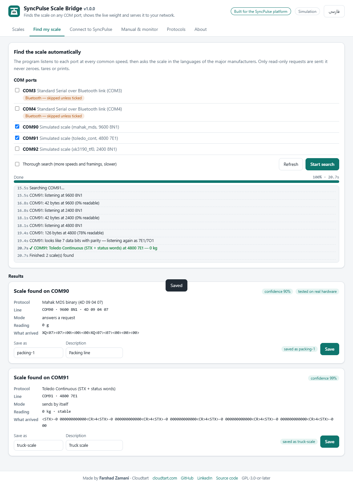
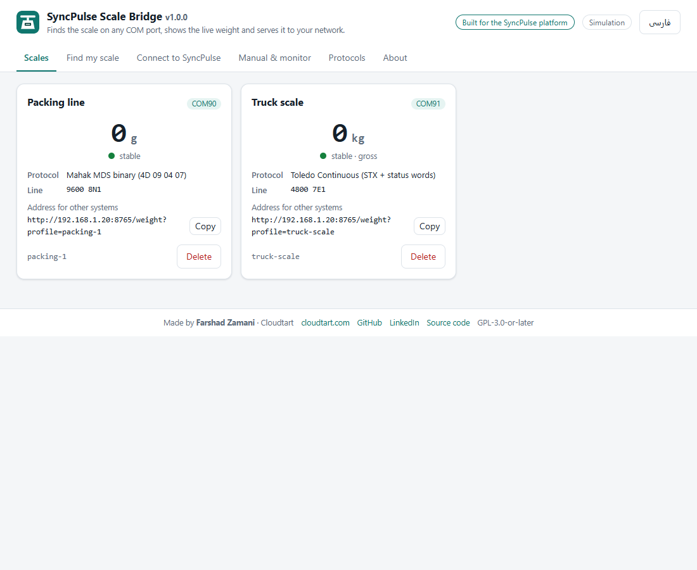

<p align="center"></p>

<h1 align="center">SyncPulse Scale Bridge</h1>

<p align="center">
Plug an RS-232 weighing scale into any Windows PC, run one file, and it finds the port, the speed and
the protocol by itself — then shows the live weight and serves it to your network as JSON.
</p>

<p align="center">
<a href="https://github.com/farshad-zamani/syncpulse-scale-bridge/actions/workflows/ci.yml"></a>
<a href="https://github.com/farshad-zamani/syncpulse-scale-bridge/releases/latest"></a>
<a href="LICENSE"></a>

</p>

<p align="center"><b>English</b> · <a href="README.fa.md">فارسی</a></p>

---

Built by **[Farshad Zamani](https://github.com/farshad-zamani)** at **[Cloudtart](https://cloudtart.com)** for
**SyncPulse**, a platform for digital forms, production records and reporting in factories, where the weight
goes straight into the form an operator is filling in. It is free software and works with any other system
through a small HTTP/JSON interface.

<p align="center">


</p>

## Why

Most industrial scales and weighing indicators still talk over a serial port, and every brand uses its own
format, speed and framing. Connecting one usually means finding the manual, guessing 9600 8N1 or 2400 7E1,
writing a parser, and keeping a program running on the PC beside the scale. This project does all of that:

- **Finds the scale by itself** — listens on every COM port at every common speed, recognises 7-bit/parity
  framing, then asks the scale in the languages of the major manufacturers. Only read-only requests are sent:
  it never zeroes, tares or prints.
- **Reads many formats** — Mettler Toledo MT-SICS and Toledo Continuous, A&D, SMA (Rice Lake, Avery
  Weigh-Tronix, Cardinal, Fairbanks…), NCI, Ohaus, Sartorius SBI, CAS, the Chinese XK3190 family, Mahak MDS, any
  readable text, and custom binary/text formats you describe.
- **Shows and serves the weight** — a bilingual (English/Persian) page on the PC, and a JSON API with value,
  unit, stability, net/gross, overload and a checksum check, for SyncPulse or any other system.
- **One file, nothing to install** — `SyncPulseScaleBridge.exe`. Copy it next to the scale and run it.
- **Production-ready** — survives unplugged USB cables and busy ports, opens the Windows Firewall port and
  starts with Windows from a button (UAC prompt), keeps an access key, and logs to a rotating file.

## Quick start (Windows)

1. Download `SyncPulseScaleBridge.exe` from the [latest release](https://github.com/farshad-zamani/syncpulse-scale-bridge/releases/latest)
   and copy it to the PC the scale is connected to — preferably into its own folder, e.g. `C:\ScaleBridge\`
   (its settings file `bridge.json` and log are kept beside it).
2. Connect the scale's RS-232 port (directly, or through a USB-serial adapter) and switch the indicator's
   serial output on.
3. Double-click the program. A console window opens (keep it open) and the control page opens in the browser
   at `http://127.0.0.1:8765/`.
4. **Find my scale → Start search.** When the scale is found, give it a name (e.g. `packing-1`) and **Save**.
   The **Scales** tab now shows its live weight.
5. **Connect to SyncPulse:** note the address and the access key, press **Open port 8765 in the firewall**
   and, if the bridge should run without anyone logged in, **Start with Windows**.

No hardware at hand? Try it with simulated scales:

```bat
SyncPulseScaleBridge.exe --simulate mahak_mds,toledo_cont:4800:7E1,mt_sics
```

## How auto-detection works

For each selected port:

1. **Listen** at 9600, 2400, 4800, 19200, 1200, 38400, 57600 and 115200 baud (8N1). A scale that sends by
   itself appears here. If the bytes are only readable once their top bit is cleared, the line uses 7 data bits
   with parity, and the port is listened to again as 7E1/7O1. What arrives is matched against every
   continuous format; framed formats with checksums win over loose text.
2. **Ask** — if nothing useful was heard, every read-only request in the library is sent at each speed and
   framing (quick: 8 combinations; thorough: 14) and the reply is checked by the protocol that was asked. A
   reply is confirmed by asking a second time.

Each result has a confidence score, the exact line settings, the request, a sample of the raw data and the
current reading. A port that sent readable data in an unknown format is reported with that sample, so it can be
configured by hand on the **Manual & monitor** tab.

Auto-detection reserves the ports it searches; reads of those ports answer `409 busy` until it finishes.

### Scales that send only when Print is pressed

Many indicators — especially those wired to a label printer — stay silent until the operator presses *Print*,
then send the whole label. Tick **The scale sends only when Print is pressed** (and, if you like, **Listen only**)
and press Print when the page asks: the port is held open at one speed until data arrives; unreadable data means
another speed, and the next press is awaited at the next one. One press is enough for 7E1/7O1.

For such a scale the bridge keeps the port **open all the time** and records every label: weight, unit and the
other values on the label (order number, shift, date …) in `labels/<profile>-YYYY-MM-DD.jsonl` beside
`bridge.json`, and the last 500 through `GET /labels`. To keep the label printer working, connect the PC with a
**Y cable**: scale TX (and ground) to both the printer and the PC's RX; the PC never transmits on that line.

## Supported formats

| ID | Format | Talks | Used by (examples) |
|---|---|---|---|
| `mt_sics` | Mettler Toledo MT-SICS (`SI`) | on request | Mettler Toledo terminals and balances |
| `toledo_cont` | Toledo Continuous (STX + status words, checksum) | continuous | Mettler Toledo IND/Panther/Jaguar/Lynx and many compatible indicators |
| `and_std` | A&D standard (`ST`/`US`/`OL`, `Q`) | on request / continuous | A&D and many Asian indicators |
| `sma` | SMA SCP-0499 (`<LF>W<CR>`) | on request | Rice Lake, Avery Weigh-Tronix, Cardinal, Fairbanks… |
| `nci` | NCI 3835 (`W<CR>`) | on request | NCI / Weigh-Tronix shipping scales |
| `ohaus` | Ohaus (`IP`) | on request | Ohaus Defender, Ranger, Valor… |
| `sartorius` | Sartorius SBI (`ESC P`) | on request | Sartorius balances, Combics/Signum |
| `cas_enq` | CAS ENQ/ACK/DC1 *(experimental)* | handshake | CAS and compatibles |
| `xk3190_tf0` | XK3190 continuous (tF=0, XOR checksum) | continuous | Yaohua XK3190-A9/A12 and compatibles |
| `xk3190_reversed` | XK3190 `=` reversed-digit stream — **tested on real hardware** (YH-T7E) | continuous | Yaohua XK3190 series, YH-T7E, big displays |
| `mahak_mds` | Mahak MDS binary (`4D 09 04 07`) — **tested on real hardware** | on request | Mahak MDS 13000 and related models |
| `label_print` | Label printer stream: TSPL / EPL2 / ZPL — **tested on real hardware** | on Print key | indicators wired to a TSC, Zebra or Argox label printer (e.g. PTC400) |
| `ascii_generic` | Any readable line with a number and a unit | continuous | everything else that streams text |
| `custom_binary` | A binary frame you describe (pattern, offset, length, byte order) | either | — |
| `custom_ascii` | A text format you describe (regular expression) | either | — |

The formats follow the manufacturers' published documents and are covered by tests with their sample frames;
`mahak_mds` was verified on a working scale. Brand names only describe data formats — many other indicators
copy these formats. Requests that change the scale (zero, tare, reset, print, display off) are never sent.

Missing your scale? Open the **Manual & monitor** tab, look at what arrives, and save a custom profile — or
[open an issue](https://github.com/farshad-zamani/syncpulse-scale-bridge/issues) with the model and a sample of the
raw data. See [CONTRIBUTING.md](CONTRIBUTING.md) for adding a protocol.

## Using it with SyncPulse

In SyncPulse: **Devices → your scale → RS232 connection**: bridge address = the PC's IP address, port = `8765`,
access key = the key on the **Connect to SyncPulse** tab → data format **Profile on the bridge** → choose the
profile → **Test connection**. Form cells set to *receive from device* then fill in the weight when the operator
focuses them.

Bridges of the earlier *SyncPulse Serial Bridge 1.x* can be replaced by this program in place: `POST /read` and
`bridge.json` are compatible, so existing device settings keep working.

## Using it with any other system — HTTP API

Everything below needs the header `X-Bridge-Token: <access key>` except `/health`.

| Request | Answer |
|---|---|
| `GET /health` | `{ok, service, product, version, host, simulate, author, website, repository, capabilities}` |
| `GET /ports` | the COM ports of the PC (name, description, USB IDs, chip, warnings) |
| `GET /profiles` | the saved scale profiles |
| `GET /weight?profile=packing-1` | the current weight of a saved profile |
| `GET /labels?profile=ps02&after=SEQ&limit=100` | labels printed by a print-only scale, oldest first (`seq` grows by one per label) |
| `GET /weight?port=COM7&protocol=mt_sics&baud=9600&framing=8N1` | the current weight without a profile |
| `POST /weight` `{"profile": "packing-1"}` or a whole profile | same, as JSON |
| `POST /read` `{serial, exchange, frames, max_age_ms, wait_ms}` | the raw frames (1.x contract) |

Optional on `/weight`: `max_age_ms` (default 1500 — older readings are `stale`) and `wait_ms` (default 2500 — how
long to wait for a fresh reading when the port has just been opened).

```console
$ curl -H "X-Bridge-Token: $KEY" "http://192.168.1.20:8765/weight?profile=packing-1"
{"ok": true, "profile": "packing-1", "port": "COM7", "protocol": "mahak_mds", "open": true,
 "value": 550.0, "unit": "g", "stable": true, "net": null, "overload": false, "age_ms": 84,
 "stale": false, "measured_at": "2026-10-01T10:15:02.415+03:30", "raw_hex": "58 51 07 07 00 02 26",
 "checksum_ok": null}
```

```python
import requests
r = requests.get("http://192.168.1.20:8765/weight", params={"profile": "packing-1"},
                 headers={"X-Bridge-Token": KEY}, timeout=5).json()
if r["ok"] and r["stable"] and not r["stale"]:
    print(r["value"], r["unit"])
```

`stable` comes from the scale when its format says so; otherwise it means the last *N* readings were equal
(`stable_samples`, default 3). Errors answer with `"ok": false` and an `"error"` text — `401` wrong key,
`403` client not allowed, `404` unknown profile, `409` port busy, `400` invalid request.

## Security

- **Access key** — created on first start and kept in `bridge.json`; compared in constant time. Make a new one on
  the **Connect** tab at any time.
- **Allowed clients** — optionally accept only the SyncPulse server's address(es); the firewall rule can be
  limited to one address too.
- **The control page is local only** — it opens only on the PC itself (`127.0.0.1`). Its API also requires a
  custom header and a local `Host`, which protects it from other web pages and DNS rebinding. Other machines
  get a short information page instead.
- **Read-only towards the scale** — detection and reading never send zero, tare, print or configuration
  commands.
- Keep the bridge on the factory network; it speaks plain HTTP.

## Firewall and running in the background

Windows Firewall blocks incoming connections by default, so the SyncPulse server cannot reach port 8765 until a
rule allows it. **Open port 8765 in the firewall** asks for administrator permission and runs:

```bat
netsh advfirewall firewall add rule name="SyncPulse Scale Bridge" dir=in action=allow protocol=TCP localport=8765 profile=any
```

It also removes block rules Windows may have created for the program when its *Allow access?* question was
cancelled (a block rule beats any allow rule).

**Start with Windows** registers the scheduled task *SyncPulse Scale Bridge*: runs as SYSTEM at boot (before
anyone logs in), never stopped after 72 hours, restarted every minute if it fails. Opening the program while the
background copy runs simply opens its page.

The same from the command line:

```bat
SyncPulseScaleBridge.exe firewall [--remote-ip 192.168.1.10] [--remove]
SyncPulseScaleBridge.exe autostart [--disable]
```

## Command line

```text
SyncPulseScaleBridge.exe                       run the bridge and open its page (default)
SyncPulseScaleBridge.exe ports                 list COM ports
SyncPulseScaleBridge.exe detect [--port COM7] [--thorough] [--wait-print 60] [--listen-only] [--save NAME] [--json]
SyncPulseScaleBridge.exe monitor --port COM7 --baud 9600 --framing 8N1 [--request "53 49 0D 0A"]
SyncPulseScaleBridge.exe weight --profile NAME | --port COM7 --protocol mt_sics
SyncPulseScaleBridge.exe token [--new]
SyncPulseScaleBridge.exe protocols | about | --version

Options: --config FILE  --simulate SPEC  --verbose  --listen-host  --listen-port  --no-browser  --service
```

## Troubleshooting

- **No COM port / "A device attached to the system is not functioning"** — many cheap USB-serial adapters use
  clone CH340 or PL2303 chips that recent drivers refuse. For CH340 install driver **3.5.2019.1** (Microsoft
  Update Catalog); for PL2303 use an older Prolific driver; or use an FTDI-based adapter. The port list warns
  about these chips.
- **Nothing found** — switch the serial output on in the indicator's menu (often `COM`, `rS`, `SEr`, `Serial`,
  `Continuous` or `On request`); check the cable (many indicators need a null-modem/crossed cable, some a
  straight one — pins 2, 3 and 5 are enough); put something on the scale or press *Print* while searching; try
  the thorough search; watch the raw bytes on **Manual & monitor**.
- **Garbage characters** — wrong speed or framing; the monitor shows the bytes, detection finds the right ones.
- **The server cannot connect** — check the firewall rule, the IP address, and that both machines are on the same
  network; `curl http://<ip>:8765/health` from the server must answer.
- **Antivirus warning** — single-file programs built with PyInstaller are sometimes flagged by mistake. Compare the
  SHA-256 checksum published with the release, or build the program yourself from source.

## Build from source

```bat
git clone https://github.com/farshad-zamani/syncpulse-scale-bridge
cd syncpulse-scale-bridge
scripts\build_exe.bat                 :: venv, tests, then dist\SyncPulseScaleBridge.exe
```

Or run it directly with Python 3.9+ on Windows or Linux:

```bash
pip install -r requirements.txt
python -m scale_bridge                # on Linux the ports are /dev/ttyUSB0, /dev/ttyS0 …
python -m pytest                      # the test suite (simulated scales, no hardware needed)
```

## Related projects

Useful projects that solve parts of the problem — none of them combines automatic detection, a multi-brand
protocol library, a network API and a control page:

- [VbScalesReader](https://github.com/wqweto/VbScalesReader) — VB6 library reading CAS, Elicom, Dibal, Mettler and
  Delmac protocols.
- [Weigh-Scale-To-PC](https://github.com/MaxAtoms/Weigh-Scale-To-PC) — Windows Forms display for an Arduino-based scale.
- [RS232C_Scale](https://github.com/rhemitoth/RS232C_Scale) — Raspberry Pi reader that logs a scale's readings to CSV.
- [232key](https://www.digitalscalesblog.com/free-software-scales-balances/) and similar free *keyboard wedge*
  tools — type the weight into the active window.

## License

[GPL-3.0-or-later](LICENSE) with one additional term under section 7(b): the author attribution shown by the
program — in its page footer, *About* page, `about` command and `/health` answer — must be kept in all copies and
modified versions. See [NOTICE.md](NOTICE.md).

## Author

**Farshad Zamani** — [Cloudtart](https://cloudtart.com) ·
[GitHub](https://github.com/farshad-zamani) ·
[LinkedIn](https://www.linkedin.com/in/farshad-zamani92/)

Built for the **SyncPulse** platform. Copyright © 2026 Farshad Zamani — Cloudtart.
